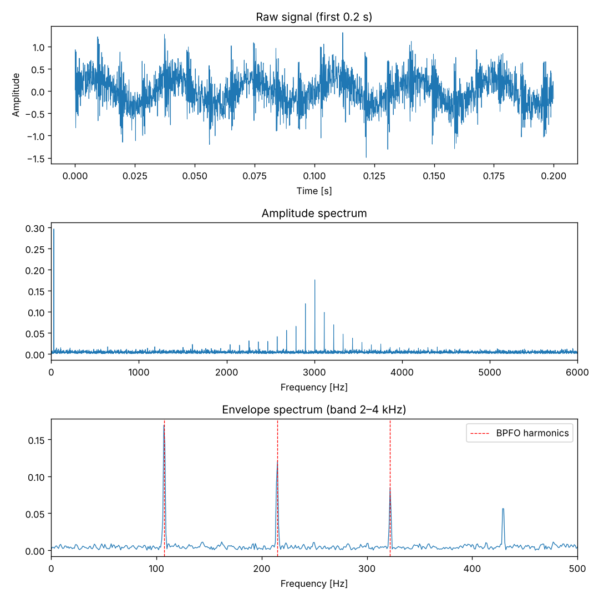

# vibration-signal-toolkit

Small, readable Python tools for **vibration-based fault diagnosis of rotating machinery**:
segmenting raw records into samples, classical condition indicators, spectral and
envelope analysis, and bearing fault characteristic frequencies.

Built as a clean preprocessing base for deep-learning bearing diagnosis experiments
(e.g. on the CWRU dataset).



## Features

| Module | What it does |
|---|---|
| `vibkit.segmentation` | Sliding-window segmentation (with overlap for augmentation), per-sample z-score / min-max normalization |
| `vibkit.features` | 11 time-domain indicators: RMS, peak, kurtosis, skewness, crest / shape / impulse / clearance factors, … |
| `vibkit.spectral` | Amplitude spectrum, band-pass filtering, Hilbert **envelope spectrum**, STFT spectrogram |
| `vibkit.bearing` | BPFO, BPFI, BSF, FTF from bearing geometry (CWRU 6205 drive-end geometry included) |
| `vibkit.datasets` | Loader for CWRU `.mat` files → `X, y` arrays ready for training |

## Installation

```bash
git clone https://github.com/zakariyaarroussi29-netizen/vibration-signal-toolkit.git
cd vibration-signal-toolkit
pip install -r requirements.txt
```

## Quick start

```python
import numpy as np
from vibkit import sliding_windows, normalize, time_features, envelope_spectrum, fault_frequencies
from vibkit.bearing import CWRU_DE_6205

fs = 12_000                                   # CWRU 12 kHz drive-end data
x = np.load("my_signal.npy")                  # any 1-D vibration record

# 1) Cut into 1024-point samples with 50% overlap, normalize each one
X = normalize(sliding_windows(x, length=1024, stride=512))

# 2) Classical indicators (n_samples x 11)
F = time_features(X)

# 3) Expected fault frequencies at 1797 rpm
print(fault_frequencies(CWRU_DE_6205, shaft_hz=1797 / 60))
# {'BPFO': 107.4, 'BPFI': 162.2, 'BSF': 70.6, 'FTF': 11.9}

# 4) Envelope spectrum around a resonance band
f, a = envelope_spectrum(x, fs, band=(2_000, 4_000))
```

### Loading CWRU data

Download the `.mat` files from the
[Case Western Reserve University Bearing Data Center](https://engineering.case.edu/bearingdatacenter)
into a local `data/` folder (not tracked by git), then:

```python
from vibkit.datasets import build_dataset

X, y = build_dataset(
    {"data/97.mat": 0,    # normal
     "data/105.mat": 1,   # inner race, 0.007"
     "data/118.mat": 2,   # ball, 0.007"
     "data/130.mat": 3},  # outer race, 0.007"
    length=1024, stride=512,
)
```

## Demo

```bash
python examples/demo_outer_race_fault.py
```

Simulates periodic impacts from an outer-race defect exciting a 3 kHz resonance,
buried in noise. The fault is hard to see in the raw signal and the plain spectrum,
but the envelope spectrum shows clear peaks at BPFO (107.4 Hz) and its harmonics.

## Tests

```bash
pytest
```

Tests check the spectra against known sine amplitudes, the features against analytical
values, and the fault frequencies against the published CWRU values.

## License

MIT — see [LICENSE](LICENSE).

## Author

**Zakariya Arroussi** — PhD student, Mechanical Engineering, East China University of Science and Technology (ECUST).
